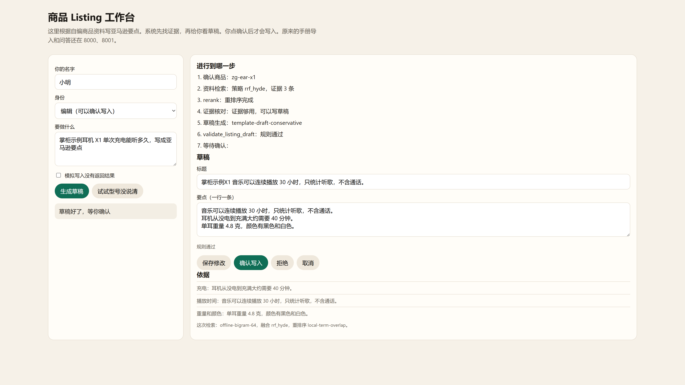
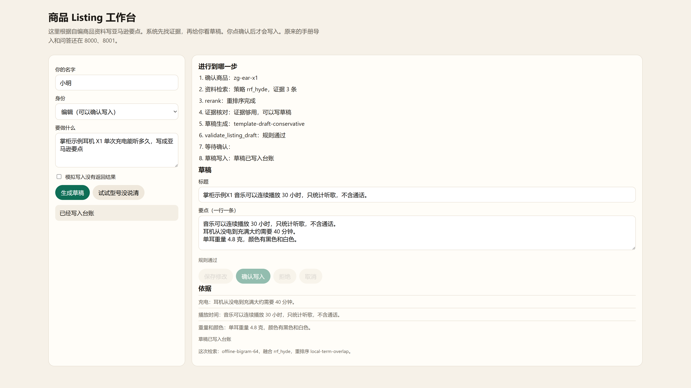

# 掌柜智库

[](https://github.com/heYC3/zhanggui-zhiku/actions/workflows/listing-ci.yml)

独立开发的电商产品知识 RAG，外加一个 Listing 工作台。手册导入、问答和 Listing 都是自己实现并跑通的：把产品说明书放进去，再用口语提问；Listing 按资料原句写标题和要点，确认之后才写入。

实现时参考开源组件与公开资料，用的是 LangGraph。Listing 的冻结测集、任务完成率和人机确认是个人新增。

## 目录

```text
knowledge_base/
├── app/
│   ├── server.py            一次打开导入、问答、Listing 三个页面
│   ├── import_process/      导入手册
│   ├── query_process/       回答问题
│   └── listing_agent/       Listing 工作台（页面、流程、评测）
├── listing_data/
│   ├── products/            3 个自编商品，不是在售商品
│   ├── eval/                开发集 dev.json，冻结测集 frozen_test.json
│   └── reports/baseline.md  冻结测集基线
├── deploy/                  Milvus、MinIO、MongoDB，以及 Listing 容器
├── requirements-listing.txt 只跑 Listing
├── requirements-rag.txt     完整 RAG（导入和问答）
└── .env.example             配置样例，复制成 .env 再填
```

## 快速开始

两条路分开。只想看 Listing，走第一条，不需要虚拟机、向量库和模型密钥。

### 只跑 Listing

```powershell
cd knowledge_base
pip install -r requirements-listing.txt
python -m app.listing_agent.eval
python -m unittest discover -s test/listing -v
python -m app.listing_agent
```

评测会重算冻结测集，并对照 `listing_data/reports/baseline.md`。页面在 <http://127.0.0.1:8002/listing.html>。

GitHub Actions 跑同样的单元测试和 `python -m app.listing_agent.eval`。基线表和仓库里的 `baseline.md` 不一致时，流水线失败。

### 完整 RAG

需要 Python 3.11、自己的模型密钥，以及 Milvus、MinIO、MongoDB。

```powershell
cd knowledge_base
copy .env.example .env
docker compose -f deploy/docker-compose.yml up -d
pip install torch torchvision torchaudio --index-url https://download.pytorch.org/whl/cpu
pip install -r requirements-rag.txt
python -m app.server
```

`.env` 按 `.env.example` 填写，不要把填好的文件提交。数据库起来之后，把地址写进 `MILVUS_URL`、`MINIO_ENDPOINT`、`MONGO_URL`。

- 导入：<http://127.0.0.1:8000/import.html>
- 问答：<http://127.0.0.1:8001/chat.html>
- Listing：<http://127.0.0.1:8002/listing.html>

可以先上传 `knowledge_base/data/samples/示例-掌柜耳机说明书.md`。这是短的演示文稿，不经过 PDF 解析。导入完成后再问「掌柜示例耳机 X1 续航多久」。

PDF 手册要另备 MinerU 令牌。BGE-M3 在第一次向量化时按 `BGE_M3` 下载；没有显卡就保持 `BGE_DEVICE=cpu`、`BGE_FP16=0`。

## 实现范围

导入、问答、Listing 三条链路是端到端独立完成的。Listing 用一句话指定商品，先确认型号，再从自编资料里找证据，只用证据原句拼标题和要点。资料没写的不补。X1 和 X1 Pro 分不清时先追问，不写草稿。

个人新增的是 Listing 评测和人机确认。问答检索排位和 Listing 任务完成率分开计，不合成一个数。

运行上做了这些处理：MinIO 没启动时网页仍能打开；向量模型在真正编码时再加载；问答有状态查询和流式错误。

## Acknowledgements

参考开源组件与公开资料，自己把导入、问答和 Listing 落地。厂商手册没有放进仓库。Listing 的商品、规则、评测题和确认流程是个人新增。许可是 [MIT](LICENSE)。

## 两条能力

问答和 Listing 是两个接口、两条工作流。它们只共用证据检索：同一商品返回原句、`chunk_id` 和来源。目录里有的演示商品走离线资料；目录里没有的手册再走 Milvus。

| 能力 | 出口 | 指标 |
| --- | --- | --- |
| 手册问答 | `8001` `/chat.html` | 检索排位 hit@1、hit@3 |
| Listing | `8002` `/listing.html` | 任务完成率，一题一次，成功或失败 |

下面的完成率和 hit@k 仍是两张表。

## 冻结测集基线

100 条题拆成开发集 62 条、冻结测集 38 条。字段是问题、标准要点、证据位置、题型。完成率只算冻结集里的 7 条草稿题和 9 条流程题：一条题一次任务，成功或失败。2026-11-06 用离线字块重跑，没有加载 BGE-M3，没有调用付费模型。

成功要同时满足：型号对，证据命中标准位置，资料要点至少写进草稿 1 条，禁语 0 条。流程题还要确认路径正确。

| 配置 | 成功/总数 | 完成率 |
| --- | --- | --- |
| Before：关键词检索，无确认门，无规则校验 | 11/16 | 68.8% |
| After：当前默认链路（RRF+HyDE、确认、规则、重排序可降级） | 16/16 | 100.0% |

Before 没过的 5 条里，2 条是改写问法没有找回目标证据，3 条是指代续问没有走确认门。After 在这 16 条上是满的。这是小集合上的结果，不是线上提升。问答完成率没有写，冻结集里没有「答案是否覆盖标准要点」的问答题。

下面的 hit@k 只看检索排位，不是完成率。

| 题型 | 条数 | 关键词 hit@1 | 关键词 hit@3 | 稠密 hit@1 | 稠密 hit@3 | RRF hit@1 | RRF hit@3 | RRF+HyDE hit@1 | RRF+HyDE hit@3 |
| --- | --- | --- | --- | --- | --- | --- | --- | --- | --- |
| 关键词检索 | 8 | 8/8 | 8/8 | 8/8 | 8/8 | 8/8 | 8/8 | 8/8 | 8/8 |
| 改写检索 | 13 | 4/13 | 5/13 | 5/13 | 12/13 | 5/13 | 12/13 | 5/13 | 13/13 |
| 型号区分 | 1 | 1/1 | 1/1 | 1/1 | 1/1 | 1/1 | 1/1 | 1/1 | 1/1 |
| 检索合计 | 22 | 13/22 | 14/22 | 14/22 | 21/22 | 14/22 | 21/22 | 14/22 | 22/22 |

保守草稿 14 条：写出标准要点 12/14，写出禁用说法 0/14，费用 0。流程题 9 条：通过 9/9。

关键词检索在这份小目录上几乎饱和。改写检索的 hit@1 只有 4/13 到 5/13，hit@3 要靠稠密或 RRF 才到 12/13，加上模板 HyDE 才到 13/13。逐题记录在 `knowledge_base/listing_data/reports/baseline.md`。

## 系统怎么工作

**导入手册**

1. 看文件是 PDF 还是 Markdown。
2. PDF 交给 MinerU，转成带标题的 Markdown。
3. 手册里的图片上传到 MinIO，并用视觉模型写成文字说明。
4. 按段落切开，每段前面带上所属标题。
5. 认出这份手册在讲哪一款产品。
6. 用 BGE-M3 同时做出语义向量和关键词向量。
7. 写入 Milvus 的两个集合：`kb_item_names`（产品名）、`kb_chunks`（正文切片）。

**回答问题**

1. 结合聊天记录，确认用户在问哪款产品，并把问题改写清楚。
2. 同时走三条搜索：向量搜索、假设性文档搜索（HyDE）、联网搜索。
3. 用 RRF 把三路结果合成一份名单。
4. 用重排序模型留下最相关的几段。
5. 大模型根据这几段写出答案，网页上逐字显示。

联网搜索和重排序 `qwen3-rerank` 都走百炼。`.env` 里 `WEB_SEARCH_ENABLE=true`，并填写 `DASHSCOPE_API_KEY` 后才会调用。2026-11-05 实测：搜索「北京今天天气」返回 5 条，第一条标题是「北京今日天气」；「连续播放 30 小时」的相关分是 0.6417，无关句是 0.2202。钥匙失效或额度用完时，搜索失败只用本地手册，重排序失败退回 RRF。

导入流程图在 `app/import_process/agent/kb_import_workflow.py`，问答流程图在 `app/query_process/agent/kb_query_workflow.py`。另有一个 `kb_query_workflow_v2.py`，网站目前走第一版。

## Listing 工作台

页面在 <http://127.0.0.1:8002/listing.html>。





上面两张图是 2026-11-05 用默认问题跑出来的：先给出带证据的草稿，点确认后状态变成「已经写入台账」。写入的是本机台账，不是真实店铺。

流程：

1. 确认型号。两个耳机都对得上时，先问你，不写草稿。
2. 从 `listing_data/products` 找证据。
3. 草稿来源可以选。`offline` 用证据原句拼标题和要点，不调用模型。`llm` 把同一份证据交给真实模型，模型只能填写标题、要点和缺口，输出先过 JSON Schema。资料没写的，例如防水，不会补进标题和要点。默认先走百炼的 `qwen-plus`，走不通再改 OpenAI 的 `gpt-6.1-terra`。两家都走不通，就用知识库里的原句。
4. 规则检查通过后，等你点确认、拒绝或取消。确认才写入。原句、换一家模型、改用知识库，都是这样。
5. 如果写入没有返回成功或失败，页面会让你核对，不会自动再写一遍。

| 地址 | 作用 | 你要交的内容 | 返回 |
| --- | --- | --- | --- |
| `POST /api/listing/sessions` | 登录 | `user_id`、`password` | 令牌。之后的请求带 `Authorization: Bearer` |
| `POST /api/listing/tasks` | 开始写草稿 | `query`。身份以令牌为准 | 任务编号、步骤、草稿、证据 |
| `GET /api/listing/tasks/{task_id}` | 看当前进度 | 路径里的任务编号 | 同上 |
| `GET /api/listing/stream/{task_id}` | 用 SSE 看步骤 | 任务编号 | 一步一步的事件 |
| `POST /api/listing/tasks/{task_id}/confirm` | 确认写入 | `draft_version`。编辑身份来自令牌 | 写入回执 |
| `POST /api/listing/tasks/{task_id}/reject` | 拒绝 | 名字和编辑身份 | 状态变为已拒绝 |
| `POST /api/listing/tasks/{task_id}/cancel` | 取消 | 名字和编辑身份 | 状态变为已取消 |
| `POST /api/listing/tasks/{task_id}/reconcile` | 结果不明时核对 | `found` 为 true 或 false | 核对后的状态 |

未登录返回 401。看别人的任务、进度或会话返回 404。查看身份对自己的任务点确认返回 403。同一个幂等键、同一份内容会回到原任务；同一把键换了内容返回 409。`inject_write_unknown` 只在 `LISTING_TEST_MODE=1` 时接受。

查看身份不能确认写入。草稿版本不对也不能写入。

规则校验可以单独当 MCP 用。服务按官方 Python SDK 2.3.0 的 stdio 收发，一行一条 JSON。工作目录在 `knowledge_base`：

```powershell
python -m app.listing_agent.mcp_server
python -m app.listing_agent.mcp_probe
```

第二条会用官方客户端做初始化、列出工具、调用和参数错误检查，并把记录写到 `listing_data/reports/mcp_client_record.json`。说明在 `app/listing_agent/SKILL.md`。工具只有查证据和检查草稿，不直接写入。

真实模型和原句模板的对照不进冻结基线。配好模型密钥后另跑：

```powershell
python -m app.listing_agent.llm_compare
```

对照表在 `listing_data/reports/llm_compare.md`，每次调用的模型名、参数、提示版本、token、耗时和失败类型在 `llm_draft_telemetry.jsonl`。接口没返回用量时，这些数是空的，不会写成 0。

`LISTING_USE_BGE=1` 才会加载 BGE-M3，失败就退回离线字块。Langfuse 三项都填了，任务记录才会发到云端；不填只写 `listing_data/runtime/traces.jsonl`。

Listing 容器在 `deploy/Dockerfile.listing`：

```bash
docker compose -f deploy/docker-compose.listing.yml up --build
```

还没做的事：没有连接真实店铺；台账和检查点是 SQLite，没有另加 PostgreSQL；默认草稿仍是原句模板，不调用付费模型；页面是一个 HTML；仓库里没有附带已经构建好的镜像。

## 配置

开关都在 `knowledge_base/.env`。先复制 `.env.example`，再填自己的值。样例里的密钥是占位符。

| 配置 | 作用 |
| --- | --- |
| `OPENAI_API_KEY` / `OPENAI_BASE_URL` | 文本模型和看图模型 |
| `LLM_DEFAULT_MODEL` / `VL_MODEL` | 模型名。样例里的文本模型只支持温度 1 |
| `MINERU_API_TOKEN` | PDF 转 Markdown |
| `DASHSCOPE_API_KEY` | 百炼联网搜索和 `qwen3-rerank` |
| `WEB_SEARCH_ENABLE` | 设为 `true` 才走第三路联网搜索 |
| `MILVUS_URL` | 向量库 |
| `MINIO_ENDPOINT` | 手册图片 |
| `MONGO_URL` | 问答聊天记录 |
| `BGE_M3` / `BGE_M3_PATH` / `BGE_DEVICE` | 向量模型。`BGE_M3_PATH` 留空则按模型名下载 |
| `TEXT_RERANK_MODEL` | 默认 `qwen3-rerank` |
| `LISTING_USE_BGE` | Listing 默认 `0`，不加载 BGE-M3 |
| `LISTING_DRAFT_MODE` | `offline` 用原句模板；`llm` 才调用文本模型。页面上也可以切换 |
| `LISTING_LLM_PROVIDER` | 默认 `bailian`。失败再换另一家，两家都失败用知识库原句 |
| `LISTING_BAILIAN_MODEL` | 百炼草稿模型，默认 `qwen-plus`。同一条草稿上比 `qwen3.8-flash` 快。`qwen3-rerank` 只做问答重排序 |
| `LISTING_OPENAI_MODEL` | 百炼失败后改用的 OpenAI 模型，默认 `gpt-6.1-terra`。问答仍用 `LLM_DEFAULT_MODEL` |
| `LISTING_LLM_TIMEOUT_S` | 真实模型草稿的超时秒数 |
| `LISTING_LLM_USD_PER_MILLION_PROMPT` / `LISTING_LLM_USD_PER_MILLION_COMPLETION` | 两项都有，才用 token 算费用。缺了就留空 |

## 许可

采用 [MIT](LICENSE) 许可。
