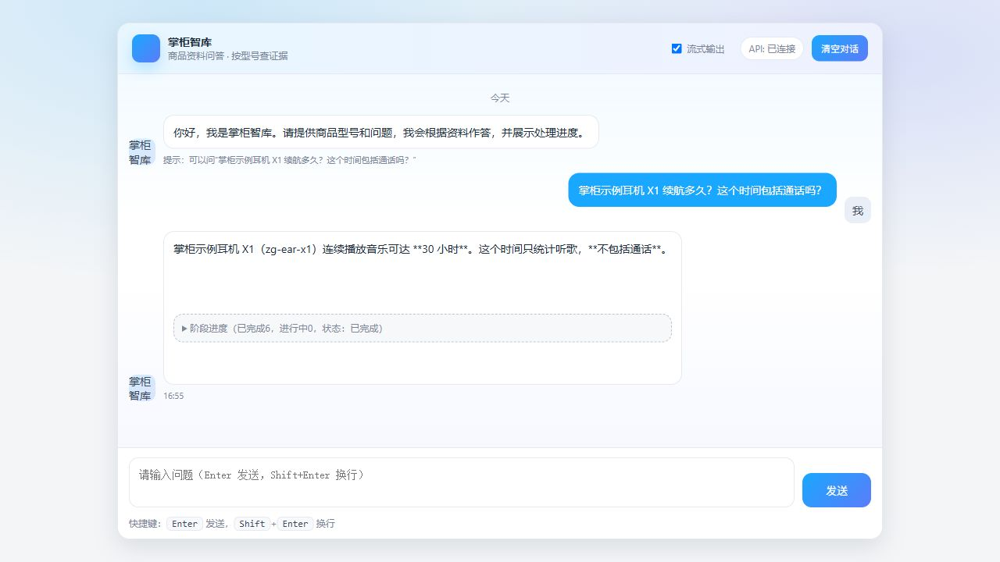
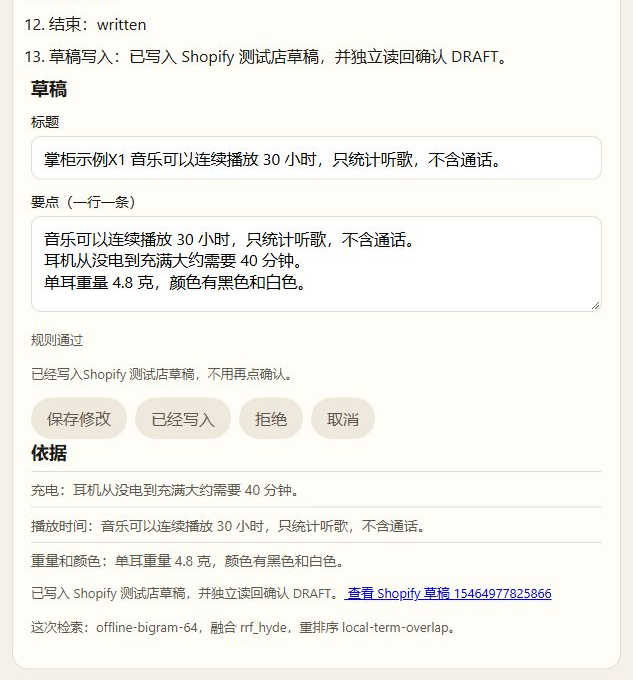
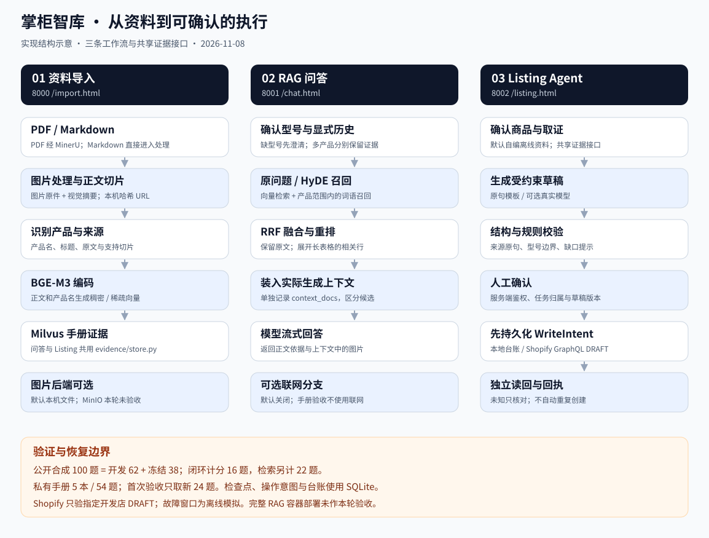

# 掌柜智库

基于 LangGraph 的商品知识 RAG 与 Listing Agent：从产品资料检索证据，回答售前问题，生成可审核的商品文案草稿。

[](https://github.com/heYC3/zhanggui-zhiku/actions/workflows/listing-ci.yml)

[](LICENSE)

商品参数分散在手册里，相近型号容易串用，生成文案又可能补出资料没有的卖点。这个项目将资料导入、证据检索、内容生成与人工确认连接起来：问答提供依据，Listing 在校验和确认后写入本地台账，或接入指定 Shopify 开发店创建 DRAFT。

技术栈：**Python · FastAPI · LangGraph · BGE-M3 · Milvus · SQLite · SSE · MCP**。

## 项目演示

**问答：完整型号提问，保留资料中的使用限制。** 下图使用公开自编 X1 资料、离线证据后端与真实模型；关闭联网，不是远程 Milvus 入库后的验收。



**Listing：查看草稿与原始证据，再由人工确认。**


[查看确认后写入台账的画面](docs/listing/written.png)。默认演示使用自编商品和离线证据，不需要模型密钥；也提供真实模型草稿路径。可选 Shopify 模式已通过本机真实草稿创建与读回，见[接入与验收](docs/shopify.md)。

**Shopify：确认后创建指定开发店 DRAFT，独立读回并恢复同一回执。**



[查看实操图集](docs/gallery.md)：问答、导入排障、草稿与回执、架构、评测摘要和 MCP 调用。每张图都注明来源与验证范围。2026-11-08 补图时远程 Milvus 连接失败，导入图保留真实失败状态。

## 重点实现

| 方向 | 实现 | 代码入口 |
| --- | --- | --- |
| 资料与证据 | PDF / Markdown 导入、封面缺字补充、图片摘要、带来源的正文切片；问答和 Listing 共享证据接口 | [导入工作流](knowledge_base/app/import_process/agent/main_graph.py) · [证据层](knowledge_base/app/evidence/store.py) |
| RAG 问答 | 精确型号与澄清、按产品召回、稠密与稀疏检索、HyDE、RRF、长表格重排；记录实际生成上下文 | [问答工作流](knowledge_base/app/query_process/agent/kb_query_workflow.py) · [手册检索](knowledge_base/app/evidence/manual_retrieval.py) |
| Listing Agent | 证据约束草稿、结构与规则校验、缺口提示、人工确认；可选真实模型，失败回退原句 | [Listing 工作流](knowledge_base/app/listing_agent/workflow.py) · [模型草稿](knowledge_base/app/listing_agent/llm_draft.py) |
| 执行与恢复 | 令牌鉴权、任务归属校验、草稿版本检查、幂等写入、SQLite 检查点、结果不明时核对、SSE 进度 | [API](knowledge_base/app/listing_agent/api.py) · [服务](knowledge_base/app/listing_agent/service.py) |
| Shopify 测试店 | 持久化写入意图、仅建 DRAFT、独立读回、完整操作标记核对；未知结果不重建 | [适配器](knowledge_base/app/listing_agent/shopify_adapter.py) · [写入事务](knowledge_base/app/listing_agent/shop_write.py) |
| 在线测试与维护 | 单账号安全 Cookie 登录、在线任务用量统计、单实例运行锁、完整运行目录备份恢复 | [部署校验](knowledge_base/app/listing_agent/deployment.py) · [备份恢复](knowledge_base/app/listing_agent/backup.py) · [PythonAnywhere](docs/pythonanywhere.md) |
| 工具与评测 | 官方 MCP SDK 的查证据与校验工具；合成回归、冻结基线、真实手册一次性验收分别计分 | [MCP 服务](knowledge_base/app/listing_agent/mcp_server.py) · [测试](knowledge_base/test) |

这是个人工程项目。重点开发与核验范围包括共享证据、型号边界、多产品检索、受控草稿、确认与恢复流程，以及评测和故障归因。实现使用开源组件；项目代码与自编演示数据按 [MIT](LICENSE) 发布，第三方手册不随仓库分发。

## 验证结果

截至 2026-11-08，不同任务分别计分，不合成一个准确率。

| 验证 | 范围 | 结果 |
| --- | --- | --- |
| Listing 离线闭环 | 自编商品冻结集中的 16 道草稿 / 流程题 | 关键词基线 11/16；当前流程 16/16 |
| 真实手册首次验收 | 5 本手册、54 题中的 **24 道新题**；另 30 题为开发回归 | 严格整题 **23/24**；文字要点 47/47；显式选图 4/5 |
| 单元回归 | 不含真实模型调用的 RAG 与 Listing 测试 | RAG 39 项，Listing 72 项通过 |
| Shopify 真实联调 | 自编商品、指定开发店；页面确认、独立读回、重复确认与服务重启 | 同一商品保持 DRAFT；[脱敏回执](docs/listing/shopify_receipt_2026-11-08.json) |
| 在线测试版 | PythonAnywhere 单账号；外部登录、真实 P20 DRAFT、重载、备份与空目录恢复 | 同一回执恢复且重复确认不新增；[部署验收](docs/pythonanywhere.md) |

手册新题的检索 hit@3 为 20/20，前三条指定证据覆盖 45/47；实际上下文覆盖 47/47。hit@3 表示至少命中一条相关证据，不等于全部证据都排在前三。图片选取和小样本外推仍有边界。

私有题在来源核对后封存，系统固定后只运行一次；同一开发者借助 Codex 实现、出题和复核，**不是独立人工盲评**。公开仓库提供方法、合成测试和脱敏汇总，原手册、题目和完整运行留在本机。

完整口径、来源摘要与限制见 [评测说明](docs/evaluation.md)；Listing 原始公开记录见 [基线](knowledge_base/listing_data/reports/baseline.md)、[故障与恢复](knowledge_base/listing_data/reports/durability.md)。

## 快速运行

Python 3.11，在仓库根目录执行（PowerShell）：

```powershell
cd knowledge_base
python -m venv .venv
.\.venv\Scripts\Activate.ps1
python -m pip install -r requirements-listing.txt
$env:LISTING_ACCOUNTS = "小明:demo-pass:editor:org-demo"
python -m app.listing_agent
```

打开 <http://127.0.0.1:8002/listing.html>。上面的账号仅用于本地演示；登录后选择示例商品，生成草稿，再确认写入。Linux / macOS 的激活和环境变量写法见 [运行指南](docs/running.md)。

PythonAnywhere 免费在线测试版已完成外部登录、真实 DRAFT、重载与备份恢复验收，仅本人测试。见[部署记录](docs/pythonanywhere.md)及[备用部署配置](docs/deployment.md)。

无密钥回归：

```powershell
python -m pip install -r requirements-rag-tests.txt
$env:PYTHON_DOTENV_DISABLED = '1'
$env:LISTING_SHOP_BACKEND = 'local'
python -m unittest discover -s test/listing -v
python -m unittest discover -s test/rag -v
```

完整手册问答需要配置自己的模型与检索服务，见 [运行指南](docs/running.md)。CI 检查 Listing 基线、两组单元回归及 Listing 容器卷持久；不运行私有手册或付费模型。

## 架构与目录



图为当前实现结构示意；可选配置与真实验收范围见[架构说明](docs/architecture.md)和[实操图集](docs/gallery.md)。

```text
knowledge_base/
├── app/evidence/        共享证据、型号识别、手册检索与图片
├── app/import_process/  导入工作流与页面
├── app/query_process/   问答工作流与页面
├── app/listing_agent/   草稿、确认、恢复与 MCP 工具
├── listing_data/        自编商品、公开合成测集与结果
├── test/rag/            合成 RAG 回归
├── test/listing/        Listing 与恢复回归
└── deploy/              服务编排与 Listing 镜像定义
```

- [架构与实现](docs/architecture.md)：工作流、共享边界、失败与恢复。
- [运行指南](docs/running.md)：本地启动、配置、测试和接口。
- [评测说明](docs/evaluation.md)：分母、基线、首次验收和已知限制。

## 当前范围

已连接指定 Shopify 开发店，只创建 DRAFT；商品和平台规则为演示数据。PythonAnywhere 单账号公网测试与 SQLite 恢复已验收；真实店铺故障注入、多店商家授权尚未验证，不代表生产级多租户或分布式高可用。手册图片验证覆盖本机服务和真实流式浏览器显示，MinIO 后端未完成本轮验收。

[参与贡献](CONTRIBUTING.md) · [安全问题](SECURITY.md) · [MIT 许可](LICENSE)
