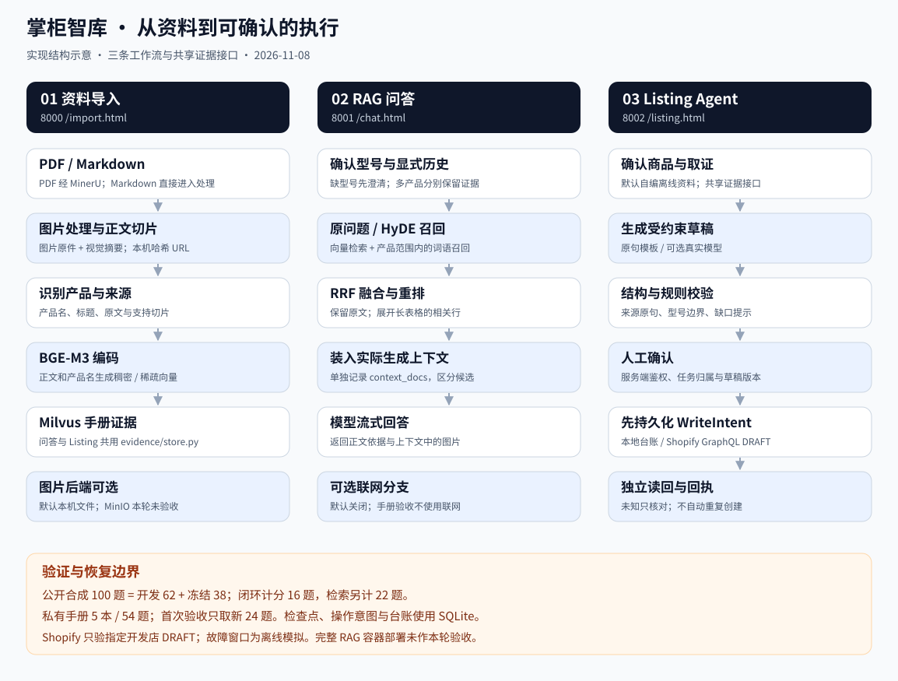

# 架构与实现

[返回首页](../README.md) · [运行指南](running.md) · [评测说明](evaluation.md)

实现结构示意，按当前代码校正。实际页面和运行记录见[实操图集](gallery.md)。

项目的实现主线是将商品资料组织为证据，经型号与多轮上下文理解完成检索生成，再将同一证据能力用于受控草稿执行。Shopify 与云端部署是执行端和服务环境的扩展；知识处理、状态编排、记忆与检索构成应用基座。

## 三条工作流

| 流程 | 输入与输出 | 实现入口 |
| --- | --- | --- |
| 导入 | PDF / Markdown → 带来源的正文与图片 → Milvus | [kb_import_app](../knowledge_base/app/import_process/agent/main_graph.py) |
| 问答 | 问题与显式历史 → 型号确认 → 证据检索 → 答案与图片 | [KBQueryWorkflow](../knowledge_base/app/query_process/agent/kb_query_workflow.py) |
| Listing | 商品要求 → 证据 → 草稿 / 缺口 → 校验 → 人工确认 → 本地台账 / Shopify DRAFT | [Listing workflow](../knowledge_base/app/listing_agent/workflow.py) |

[app/server.py](../knowledge_base/app/server.py) 启动三个本地服务，分别使用 8000、8001、8002 端口。问答和 Listing 保持不同状态与生成目标，通过 [evidence/store.py](../knowledge_base/app/evidence/store.py) 复用证据接口。演示商品使用离线资料；目录外手册使用 Milvus。两类后端的验证结果分别报告。

## 状态与工作流编排

三条流程采用预定义 LangGraph 状态图，将模型、工具与业务判断组织为明确的节点和路由。

| 流程 | 状态与控制方式 | 设计目的 |
| --- | --- | --- |
| 导入 | [ImportGraphState](../knowledge_base/app/import_process/agent/state.py) 传递文件、Markdown、切片和编码结果；入口按 PDF / Markdown 分流，再进入图片处理、切分、产品识别、编码与入库 | 不同文件复用后续知识处理步骤，保留各阶段中间结果 |
| 问答 | [QueryGraphState](../knowledge_base/app/query_process/agent/state.py) 分别记录历史、改写问题、各路候选、融合 / 重排结果、实际上下文、答案和错误；澄清直接输出，否则进入并行召回、融合、重排与生成 | 区分问题理解、召回、上下文和生成阶段，便于定位失败；并行节点只返回各自负责的字段 |
| Listing | [workflow.py](../knowledge_base/app/listing_agent/workflow.py) 组织证据、草稿、规则校验与人工确认；结合 SQLite 检查点、台账和持久化写入意图恢复执行 | 让生成与执行分开，确认、重试和重启围绕同一任务及草稿版本进行 |

问答中的原问题、HyDE 与可选联网分支并行执行；RRF 融合本地两路，联网候选在重排阶段参与。图状态保存本次任务的中间结果，MongoDB 保存跨请求会话历史，Listing 的 SQLite 检查点负责持久化执行恢复，三者职责不同。

## 多轮记忆与问题理解

[NodeItemNameConfirm](../knowledge_base/app/query_process/agent/nodes/node_item_name_confirm.py) 将历史读取、型号判断和问题改写放在检索之前：

1. 按 `session_id` 读取 MongoDB 近期消息；没有可用记录时，归一化并使用调用方传入的显式 `history`。历史库连接使用超时、初始化锁与失败退避，消息写入失败不阻断当前问答。
2. [identity.py](../knowledge_base/app/evidence/identity.py) 根据当前问题、历史和商品目录解析型号，处理别名、相近型号、指代与多型号问题。型号边界由目录匹配确定，避免将模型猜测当成已确认商品。
3. 已确定型号且存在历史时，调用结构化模型输出补全省略信息，生成独立的 `rewritten_query`；改写失败退回原问题，并附上已确认型号。
4. 歧义或未知型号进入澄清；已确认型号传给后续检索作为产品范围。用户问题、改写与产品信息写入历史，最终助手回答由答案节点保存。

因此，历史用于理解“这个”“它”等续问，事实仍由当前产品的证据提供。私有新题的产品路由 24/24、资料不足与澄清行为 4/4 是该批样本的结果；验收隔离会话并传入明确历史，不将这些数字当成 MongoDB 故障下所有多轮场景的准确率。

## 导入与证据

1. PDF 经 MinerU 转成 Markdown；原生文本可读的封面缺字由 [pdf_text.py](../knowledge_base/app/evidence/pdf_text.py) 补充，记录源 PDF 摘要、页码与编码异常。扫描页不冒充已恢复。
2. 图片保留原件，由视觉模型生成摘要。默认 [manual_assets.py](../knowledge_base/app/evidence/manual_assets.py) 发布内容哈希图片，地址为 `/manual-assets/<sha256>.<格式>`；MinIO 是可选后端。
3. 正文按标题和段落切片，识别产品后通过 BGE-M3 生成稠密 / 稀疏向量，写入 Milvus。
4. 证据接口携带 `product_id`、`chunk_id`、原文与来源。评测使用产品名和完整正文的稳定摘要，避免把数据库自增编号当成跨版本身份。

目录别名用于确认产品，不能代替正文证据。原 PDF 有、解析正文没有的内容归因到解析；召回、排序、上下文预算和生成问题分开检查。

## 问答检索

- **确认主体**：[identity.py](../knowledge_base/app/evidence/identity.py) 处理精确别名、相近型号与显式历史。缺型号或未知型号时澄清；跨型号题保留每个产品的候选。
- **召回**：原问题与 HyDE 分支进行向量检索；在确认产品范围内补充词语召回。HyDE 的猜测不加入词语检索。
- **融合与排序**：RRF 融合候选；[manual_retrieval.py](../knowledge_base/app/evidence/manual_retrieval.py) 将跨行 HTML 表格展开为可读文本，以完整正文及相关行窗口评分，并按产品交替交付。返回证据保留原文。
- **生成**：实际装入提示词的 `context_docs` 单独记录。答案引用的图片取自这些上下文，避免将未用于生成的候选算成依据。
- **失败**：向量库、编码与重排错误单列。MongoDB 聊天记录不可用时有超时和退避；BGE 采用懒加载，构造与预热由锁保护。

联网搜索是可选分支，私有手册验收关闭联网、隔离会话，只传明确历史。现有检索指标不覆盖开放网络问答质量。

知识与问答的验收覆盖 5 本手册、298 条正文；新题正文 hit@3 为 100%（20/20），严格整题通过率为 95.8%（23/24）。这些指标分别支撑证据命中与整条回答链路，显式选图仍为 4/5，不能将命中率等同于整体正确率。详细方法与边界见[评测说明](evaluation.md)。

## Listing 的受控执行

[workflow.py](../knowledge_base/app/listing_agent/workflow.py) 先确认商品，再取证据。`offline` 模式直接用原句；`llm` 模式让模型填充草稿字段，结构检查后进入规则校验，模型不可用时回退原句。

执行约束落在服务端：

| 约束 | 对应处理 |
| --- | --- |
| 身份与归属 | 服务端登记账号、Bearer 令牌、任务和机构归属检查 |
| 人工确认 | 草稿停在确认节点；查看身份不能确认，旧草稿版本不能写入 |
| 幂等写入 | 同一幂等键及同内容返回原任务；内容变化返回冲突 |
| 恢复 | SQLite 台账与 LangGraph SqliteSaver；确认前后强制结束进程的测试分开 |
| 结果不明 | 转入核对状态，不自动重复写入 |
| SSE | 进度事件持久化；订阅断开不等于取消业务任务 |

默认写入本地台账；可选 Shopify 模式将写入意图先持久化，再创建指定开发店 DRAFT，独立读回后提交回执。未知结果按完整操作 tag 和正文核对，禁止自动重建。实现与证据见[Shopify 接入](shopify.md)。本地服务不是生产认证系统，断电、跨机容灾和生产规模隔离尚无验证。

## MCP 与观测

[MCP server](../knowledge_base/app/listing_agent/mcp_server.py) 使用官方 Python SDK，提供查证据和校验草稿两个工具，不直接写台账。[客户端探针](../knowledge_base/app/listing_agent/mcp_probe.py) 覆盖初始化、工具列表、调用及参数错误，已有 [保存记录](../knowledge_base/listing_data/reports/mcp_client_record.json)。

真实模型对照记录模型、提示版本、token、耗时和失败类型；缺少用量或单价时费用记为未知。默认 trace 写本地 JSONL，配置 Langfuse 后才发送到外部服务。详见 [模型对照](../knowledge_base/listing_data/reports/llm_compare.md)。
