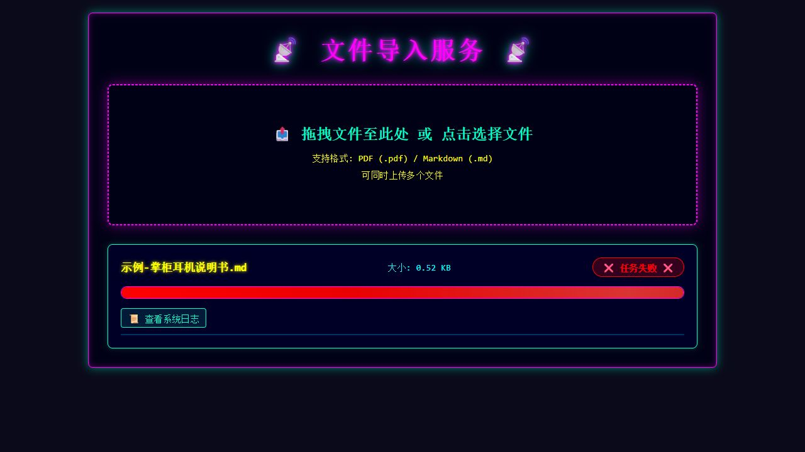
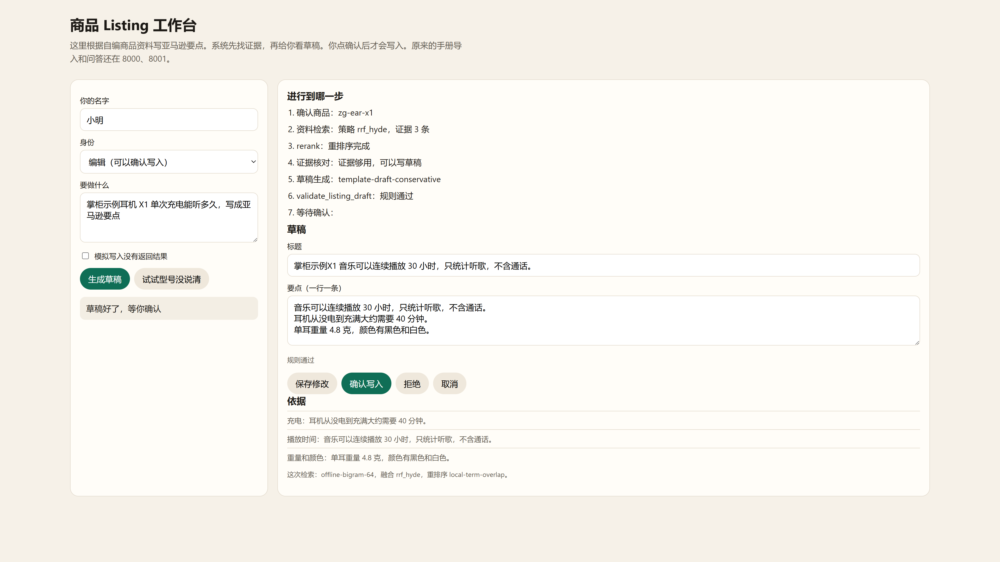
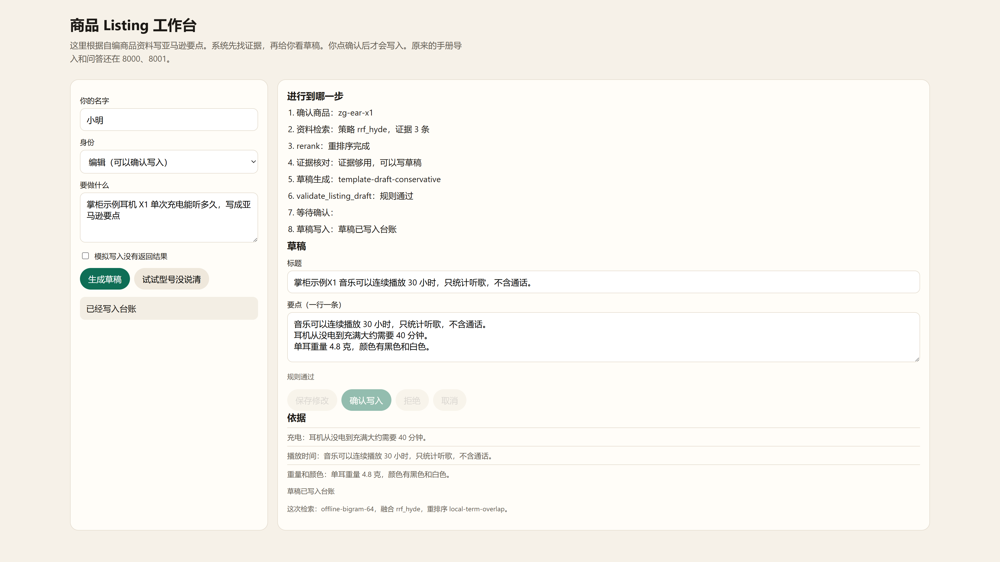
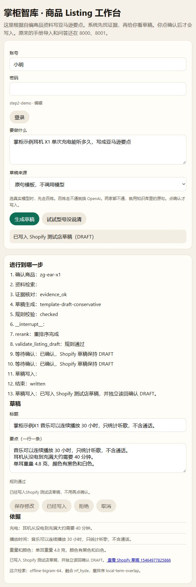
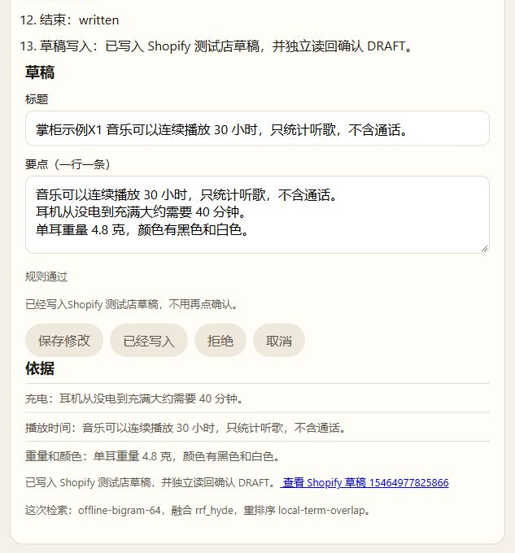
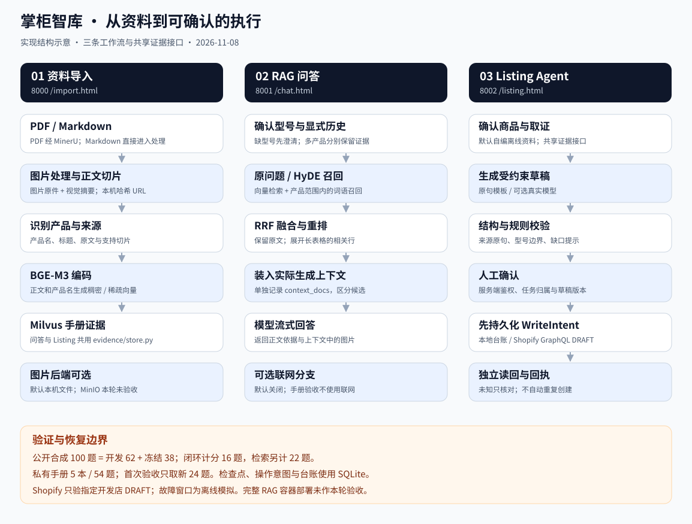
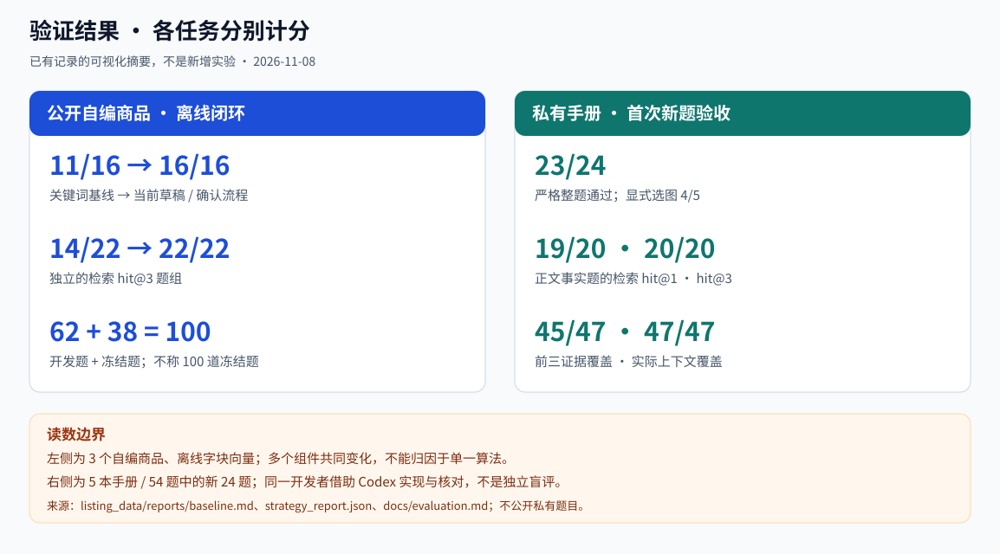
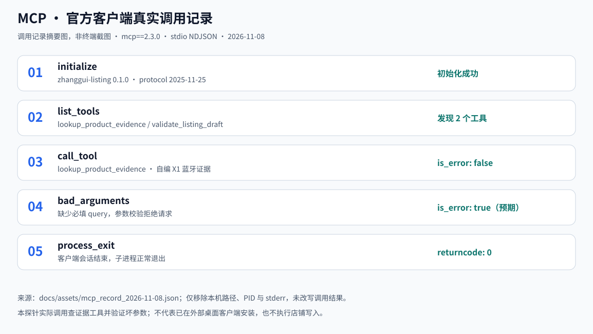
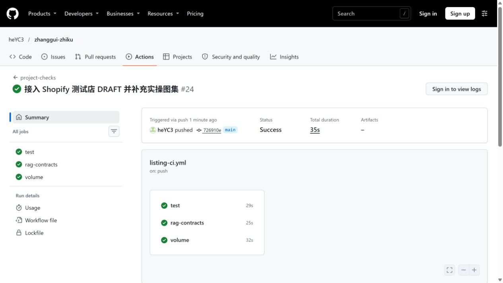
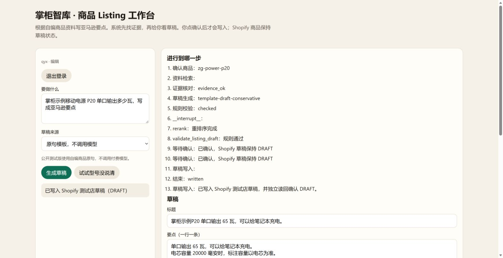

# 实操图集与证据说明

[返回首页](../README.md) · [架构](architecture.md) · [运行指南](running.md) · [评测口径](evaluation.md) · [Shopify 接入](shopify.md)

本页将实际页面、已有结果摘要与结构示意分别标注。公开画面只使用仓库自编商品，不展示厂商私有手册、私有验收题或凭据。2026-11-08 补图未重新运行私有冻结题。

## 1. 问答：保留参数的适用条件

2026-11-08 的实际浏览器页面。问题明确指定“掌柜示例耳机 X1”，资料说明音乐连续播放 30 小时，且不含通话。使用 `EVIDENCE_BACKEND=offline` 的公开自编证据、`MANUAL_CATALOG_PATH=data/samples/demo_catalog.json` 名称目录和本机配置的真实文本模型；`WEB_SEARCH_ENABLE=false`、`CHAT_HISTORY_ENABLE=false`，新会话不带私有历史。[复现启动配置](running.md#仅使用公开样例进行模型问答)。

此图验证公开证据到真实模型的页面问答，不代表本轮远程 Milvus 路径已打通。样例参数与 [X1 商品 JSON](../knowledge_base/listing_data/products/zg-ear-x1.json)、[公开 Markdown 手册](../knowledge_base/data/samples/示例-掌柜耳机说明书.md) 对齐。商品为合成演示资料，不是在售产品。

页面最终回答已返回，但阶段进度仍显示“处理中”，属于已知的提示滞后；图中保留该状态。首次配置目录时曾因名称与 SKU 不一致而未取到证据，公开目录已改用 SKU，随后对同一问题重新验证；这次开发演示不计入冻结验收。

## 2. 导入：保留真实失败状态

2026-11-08 通过 `/import.html` 上传上述自编 Markdown。任务 `f930863e-726f-4561-8f7d-37cd29027b05` 完成文件检查、Markdown 图片处理节点、正文切分、真实模型识别产品名及 BGE-M3 向量编码，共生成 1 条正文切片；在 Milvus 客户端连接阶段失败，**未成功入库**。原始任务与日志留在本机忽略目录。

本例是纯文字 Markdown，不经过 PDF / MinerU 转换，也没有调用视觉模型。页面显示失败；问答图另外使用离线证据，不能将两张图串成一次成功的导入问答验收。远程 Milvus 服务恢复后仍需重新验证该路径。

## 3. Listing：草稿、证据与人工确认

已有公开自编商品的本地模式页面，展示草稿、支持证据与确认后的台账。默认原句模板可以无模型密钥运行；真实模型草稿为独立可选路径。这两张图不作为 Shopify 远端写入证据。

## 4. Shopify：真实 DRAFT 与可恢复回执

2026-11-08 的本机工作台页面，目标为 `zhanggui-test.myshopify.com`。自编耳机商品 `15464977825866` 经真实 `productCreate` 创建为 DRAFT，并独立读回；同一任务重复确认两次、服务重启和浏览器刷新后仍恢复同一商品。

可核对 [脱敏 JSON 回执](listing/shopify_receipt_2026-11-08.json)与[完整验收说明](shopify.md)。本轮草稿使用原句模板；真实店只测正常创建、重复确认与已成功任务重启。响应丢失、崩溃、并发及核对异常等窗口由离线模拟店覆盖。

## 5. 架构：三条工作流，共享证据

实现结构示意，参考提供的三列架构布局，按当前源码校正。默认图片是本机哈希 URL，MinIO 可选；联网分支默认关闭；Shopify 通过持久化 WriteIntent、仅 DRAFT、独立读回与核对控制写入。该图不表示完整 RAG 容器部署已经验收。

## 6. 评测：保留分母与来源

此图仅可视化已有结果，不是新一轮实验。左侧来自[公开基线](../knowledge_base/listing_data/reports/baseline.md)和[逐题记录](../knowledge_base/listing_data/reports/strategy_report.json)，右侧来自[私有手册脱敏汇总](evaluation.md)。闭环题、检索题与手册新题分别计分；多个组件共同变化，不能将闭环提升归因于单一算法。私有验收由同一开发者借助 Codex 实现和核对，不是独立盲评。

## 7. MCP：官方 SDK 真实调用

2026-11-08 重跑官方客户端探针的真实记录摘要图，**不是终端截图**。`mcp==2.3.0` 通过 stdio 完成初始化、发现两个工具、调用 `lookup_product_evidence`、验证缺失 `query` 被拒绝，并以返回码 0 退出。坏参数的 `is_error: true` 是预期结果。

原始记录移除本机解释器路径、PID 与 stderr 后保存为 [公开 JSON](assets/mcp_record_2026-11-08.json)。本探针没有实际调用第二个校验工具，也不代表外部桌面客户端安装或店铺写入。[探针源码](../knowledge_base/app/listing_agent/mcp_probe.py)可复现调用。

## 8. CI：GitHub Actions 实际通过

2026-11-08 的真实 GitHub 页面，来源为[运行 #24](https://github.com/heYC3/zhanggui-zhiku/actions/runs/42403423405)，对应实现与图集提交 `726910ead43b2b36f8d2f85fd3cc3ea1fc5a968d`。`test`、`rag-contracts`、`volume` 三个任务均成功，分别检查 Listing 回归与公开基线、RAG 合成契约、容器卷两次启动后的持久化。本轮没有在 CI 调用真实模型、私有手册或 Shopify。

截图为该次运行的静态留存，后续提交状态仍应查看[实时 Actions](https://github.com/heYC3/zhanggui-zhiku/actions/workflows/listing-ci.yml)。

## 9. 在线测试版：云端登录、真实 DRAFT 与恢复

2026-11-08 的真实公网浏览器页面，来自 PythonAnywhere Beginner 的实验 ASGI 服务；仅本人一个编辑账号。自编 P20 商品 `15465550020682` 已创建为 DRAFT 并独立读回，平台重载、停服备份与空目录恢复后仍对应同一回执；重复确认后按完整操作标记查询仍只有 1 件。

云端只部署公开样例和 Listing，不上传私有手册、评测、本机数据库或模型 Key。公开原句模式没有模型调用；在线任务看板只有本次 1 个任务，用量和费用为 0。备份包含鉴权与业务数据，私有保留，不随仓库发布。见[完整部署验收](pythonanywhere.md)及[脱敏回执](listing/pythonanywhere_receipt_2026-11-08.json)。免费账号需按实际到期时间续期，实验 ASGI 不代表生产高可用。

## 图片维护

SVG 图源与生成器在 [render_diagrams.py](assets/render_diagrams.py)，只使用 Python 标准库。执行 `python docs/assets/render_diagrams.py` 可重建三张图；公开检索分数直接读取逐题 JSON，私有结果只引用已公开汇总。页面图由浏览器实际截图保存，未用注入数据制作成功状态。

CI 以 [GitHub Actions 实时状态](https://github.com/heYC3/zhanggui-zhiku/actions/workflows/listing-ci.yml)为准；本地记录的 72 项 Listing 与 39 项 RAG 通过不代替当前提交的云端 CI 结果。
