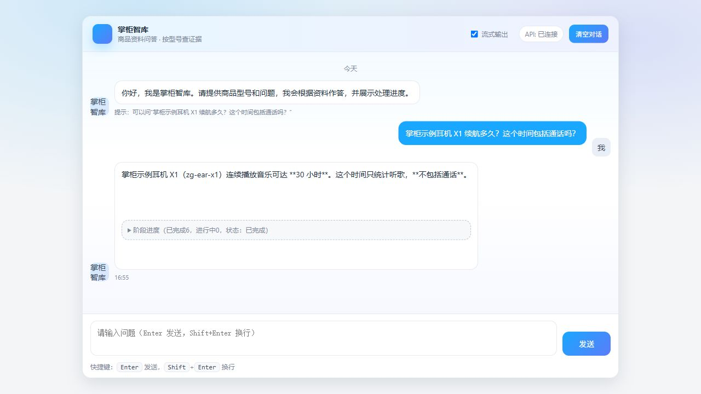

# 发布自检 · 2026-11-08

[返回首页](../README.md) · [评测口径](evaluation.md) · [实操图集](gallery.md) · [在线部署](pythonanywhere.md)

核查基线为 `15b0e3961e8cc6aa270a03712edc8dd04afd93a8`，覆盖私有手册验收、Shopify 开发店和 PythonAnywhere 在线测试版。本页记录开发者借助 Codex 完成的自检，不是独立盲评或独立安全审计。原始日志保留本机忽略目录，公开内容仅为脱敏摘要。

## 发现与修正

| 问题 | 处理结果 |
| --- | --- |
| 问答页面仍有“知识库 / 联网信息 / 万用表”旧文案，首页截图与项目定位不一致 | 统一为“掌柜智库 · 商品资料问答”，改用公开 X1 续航示例，并从真实页面重新截图 |
| 最终回答已经返回，页面仍显示处理中 | 修正终态进度；公开样例实际浏览器显示已完成 6、进行中 0。节点答案事件显示“答案已返回” |
| 第二步记录 61 项，当前文档记录 72 项 | 明确第二步当时为 Listing 61 项，第三步增加部署与恢复测试后为 72 项；原始回执保留历史值 |
| 在线入口不突出，容易将云端 Listing 理解成完整 RAG 部署 | README 增加入口并写明需要授权账号、仅本人测试；GitHub Website 已设置为在线测试版 |
| 项目元数据描述只突出设备手册；评测快照与当前发布目录的区别不够清楚 | 更新项目描述，明确验收固定的是 RAG 工作流与提示词，后续 Listing 和页面变化不回写验收快照 |
| 图集说明带有参考素材措辞；评测文案披露了不必要的私有型号 | 改为当前源码结构说明；保留缺字修复事实，省去具体型号 |

## 核验结果

| 检查 | 本轮结果与范围 |
| --- | --- |
| Listing 离线回归 | 72 项通过；禁用 `.env` 加载，固定 `local` 店铺后端 |
| RAG 合成回归 | 39 项通过；没有重新运行私有冻结题 |
| 问答真实页面 | 公开 X1 证据与真实文本模型回答保留“30 小时、不含通话”，终态进度正确；联网和历史关闭 |
| Shopify 当前状态 | 2026-11-08 08:59 UTC，通过现有适配器只读查询；X1 `15464977825866`、P20 `15465550020682` 均存在且为 DRAFT，标题型号与品牌匹配；本轮未执行创建或确认 |
| 匿名公网访问 | 9 项符合预期：首页转 Listing、工作台转登录、登录页与健康检查可达；dashboard / meta 返回 401；docs / chat / import 返回 404 |
| 已登录云端工作台 | 原 P20 任务仍显示同一保存回执；看板保留 1 个任务，0 token、0 USD。商品当前状态另由上行只读查询确认 |
| 私有验收封存 | 清单 16 个文件摘要一致；未重跑问答。唯一新题运行 SHA256 与公开评测页一致 |
| 验收系统快照 | 重算快照 110 个文件的聚合摘要一致；当前 52 个 RAG Python / prompt 文件与快照一致。页面不计入该源码摘要 |
| 凭据检查 | 对基线 204 个跟踪文件、348 个可达历史 Git blob 检查 11 个已知私密值及常见密钥格式，未命中；实际私有资料目录没有跟踪文件 |

本机回归在页面修正前完成，后端没有修改；页面修正通过真实浏览器问答复核。发布后的完整回归与容器卷检查以 [当前 GitHub Actions](https://github.com/heYC3/zhanggui-zhiku/actions/workflows/listing-ci.yml) 为准。基线提交的 [CI 运行](https://github.com/heYC3/zhanggui-zhiku/actions/runs/42461297432) 中 `test`、`rag-contracts`、`volume` 均通过。

私有结果仍为 5 本手册、54 题中的 24 道首次新题：严格整题 23/24、指定文字要点 47/47、显式选图 4/5。封存完整性检查不构成新的准确率实验，也不代表独立复现。摘要与方法见[评测说明](evaluation.md)。

## 保留的边界

- 在线地址可达，但工作台需要授权账号；云端只包含 Listing 与公开自编商品，完整 RAG 和手册导入仍在本机运行。
- 最近一次公开导入演示在 Milvus 连接阶段失败，未成功入库。本轮不重跑该导入，问答图使用离线证据，不能将两图合称一次成功入库验收。
- Shopify 真实验证限定开发店和自编商品；真实店故障注入、多店授权、生产高可用没有验收。并发和未知结果等故障窗口由离线模拟覆盖。
- `.gitignore` 中的“课程资料/”是排除规则，未跟踪该目录内容；无需为展示改动本机资料目录。旧本机演示用户名不是实际密码，首页已使用回执局部图。
- 不通过新增 Release 或改写历史 JSON 来补齐测试口径；发布版本号不代替实际功能核验。凭据扫描也只说明本轮扫描范围内未发现命中。

