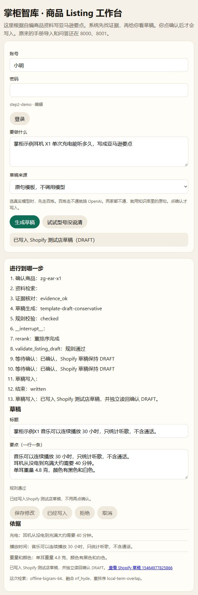

# Shopify 测试店接入与验收

[返回首页](../README.md) · [运行指南](running.md) · [脱敏回执](listing/shopify_receipt_2026-11-08.json)

2026-11-08，本机工作台已通过 Shopify 开发店的真实创建、独立读回、重复确认和服务重启验收。写入仅限 `zhanggui-test.myshopify.com`，API 版本为 `2026-10`，商品保持 `DRAFT`。

本轮商品来自仓库自编资料，草稿使用原句模板，没有调用付费模型。平台文案校验仍是演示规则，不代表完整平台合规审核。第二步验收时仅在本机运行；后续第三步已完成 PythonAnywhere 单账号公网测试，见[部署记录](pythonanywhere.md)及[云端 P20 回执](listing/pythonanywhere_receipt_2026-11-08.json)。未实现多店授权，未验证生产环境容灾。

## 本机配置与启动

将下列配置合并到 `knowledge_base/.env`，保留已有模型与数据库配置。真实 Token / Secret 只放 `.env`，不放命令行、报告或公开仓库。

```dotenv
SHOPIFY_STORE_DOMAIN=zhanggui-test.myshopify.com
SHOPIFY_ADMIN_TOKEN=<静态 Admin API Token>
SHOPIFY_CLIENT_ID=<Client ID>
SHOPIFY_CLIENT_SECRET=<Client Secret>
```

当前实测采用 legacy 静态 Admin Token。无静态 Token 时保留 client credentials 分支，但该分支未完成本轮真实验收。没有重新注册店铺、应用或变更权限。

在 `knowledge_base` 中执行（先激活项目 Python 环境）：

```powershell
git check-ignore -v .env
$env:LISTING_SHOP_BACKEND = 'shopify'
$env:LISTING_RUNTIME_DIR = Join-Path (Get-Location) 'listing_data/runtime/shopify-step2'
$env:LISTING_DRAFT_MODE = 'offline'
# 登录账号由本机 .env 的 LISTING_ACCOUNTS 登记，勿提交真实密码。
python -m app.listing_agent
```

打开 <http://127.0.0.1:8002/listing.html>。生成草稿后，页面应明确显示目标店铺与 DRAFT；点一次确认后显示商品 ID 和后台链接。本轮独立验收服务使用 `127.0.0.1:8003`，其持久化目录与上面的示例一致。

默认 `LISTING_SHOP_BACKEND=local` 继续用于离线演示。Shopify 运行目录中已有外部意图时，切回 local 会被拒绝；离线演示请使用其他运行目录。测试店凭据已在本机合并，未轮换或撤销。

`.env` 加载依次尝试显式路径、`SHOPIFY_ENV_FILE`、`knowledge_base/.env`、仓库根 `.env`，不覆盖已有环境变量。`PYTHON_DOTENV_DISABLED=1` 禁用文件加载。适配器通过服务端 HTTPS 直连，不使用系统或环境 HTTP 代理，也不向重定向地址转发凭据。

## 写入与恢复

1. 服务端核对登录用户、草稿归属、版本和规则。标题限定为品牌型号与资料原句，要点也必须来自资料。
2. 在 `ledger.sqlite3` 中提交 `write_intents`。同一任务与版本只能有一个 `operation_id`，幂等键也唯一；保存标题、HTML 正文、品牌、tags 和内容摘要。
3. 先提交 `sending`，再执行一次 GraphQL `productCreate`。远端 tag 包含完整操作 ID。适配器只发送 `status: DRAFT`。
4. mutation 返回 DRAFT 后，独立查询相同商品 ID，检查状态、标题与品牌。确认成功后，在一个事务内保存意图结果、商品回执、本地 Listing 和任务状态。
5. 超时、响应损坏、缺字段、未知异常和创建后崩溃都走核对。核对比较完整操作 tag、标题、品牌、正文与原始 tags；每次结果、时间和次数均落库。
6. 启动时恢复核对未完成意图。重复确认或 LangGraph 写节点重放读取已有意图，不再次创建。同任务操作使用进程内锁及系统文件锁，进程退出后文件锁自动释放。

| 状态 | 行为 |
| --- | --- |
| `written` | 已确认远端 DRAFT，显示真实商品回执 |
| `write_unknown` | 查询核对；一次空搜索不能证明未创建，禁止重发 |
| `write_conflict` | 远端已有商品但内容、数量或状态冲突；人工处理，不自动删除或发布 |
| `write_failed` | 请求前失败或明确业务拒绝；保留原因，不自动重试 |

Shopify 核对接口为 `POST /api/listing/tasks/{task_id}/reconcile`，请求体 `{}`。即使传入 `found: false`，也不能据此重建商品；远端结果由适配器查询。旧的人工布尔核对仅保留在 local 模式。

已持久化但尚未开始发送的意图，在启动恢复时也只查询，不自动发送。明确失败或始终未知的意图不会自动重试；需要修正配置并核对记录后，人工决定后续任务。保守恢复可能需要人工介入，但不会把空查询当成重建许可。

## 本轮验证证据

| 验证 | 结果与证据 |
| --- | --- |
| 本机服务端查询旧样本 | 读回既有商品 `15464707915850`，状态 DRAFT |
| 真实页面确认 | 创建自编耳机商品 `15464977825866`，mutation 与独立读回均确认 DRAFT |
| 真实重复确认 | 同一任务连续两次确认均返回原商品 ID；按操作 tag 查询仍唯一匹配 |
| 真实服务重启 | 同一运行目录重启后，API 与浏览器恢复同一回执；本地 Listing 行数为 1 |
| 故障与并发模拟 | 请求前失败、业务拒绝、响应丢失、解析失败、读回失败、创建后进程退出、查询超时、空搜索、同名商品、非 DRAFT、线程与双进程确认 |
| 配置与传输模拟 | 忽略本机 `.env`、保留已有环境变量、禁用代理与重定向转发、HTTP 408 / 429、GraphQL 顶层错误 |

真实店铺只做成功路径、重复确认与已成功任务重启验证；故障窗口由不联网的模拟店铺覆盖，没有在真实 Shopify 上故意制造断网或创建后崩溃。单机文件锁与 SQLite 验证不能外推到跨机、多副本或生产断电恢复。

第二步验收时的离线回归全部通过：Listing **61 项**、RAG **39 项**；本机 `.env` 加载已禁用，店铺后端固定为 local。[原始回执](listing/shopify_receipt_2026-11-08.json)中的 61 保留为当时结果。第三步增加部署与恢复测试后，截至当前发布记录为 Listing **72 项**、RAG **39 项**，当前状态以 [GitHub Actions](https://github.com/heYC3/zhanggui-zhiku/actions/workflows/listing-ci.yml)为准。历史回执不回写成后续测试数量，测试也不代表真实店铺故障注入。



本轮原始运行数据库与测试日志保留在已忽略的 `knowledge_base/listing_data/runtime/`。公开回执只含自编商品和操作证据，不含凭据。

## 再次核对与回归

默认只查询已有意图，不新增商品：

```powershell
python -m app.listing_agent.shopify_check
# 可显式指定已存在的任务或输出文件：
python -m app.listing_agent.shopify_check --task-id <task_id> --output <report.json>
```

如需另建一份固定验收示例，须显式指定写入开关。重复运行同一目录时复用固定幂等任务：

```powershell
python -m app.listing_agent.shopify_check --create-demo --confirm
```

`--create-demo` 单独使用只生成待确认草稿。已有页面任务请在页面确认；不要为了核对再次生成示例。报告中缺失的 mutation 证据保持未知，不因核对成功而补成已获得原始创建响应。

无密钥回归（不联网、不读真实 Token、不运行私有手册评测）：

```powershell
$env:PYTHON_DOTENV_DISABLED = '1'
$env:LISTING_SHOP_BACKEND = 'local'
python -m unittest discover -s test/listing -v
python -m unittest discover -s test/rag -v
```

重启真实服务前应清除测试进程中的 `PYTHON_DOTENV_DISABLED`，恢复正确后端与运行目录。测试通过不等于云端 CI 已运行，GitHub 推送状态另行报告。
